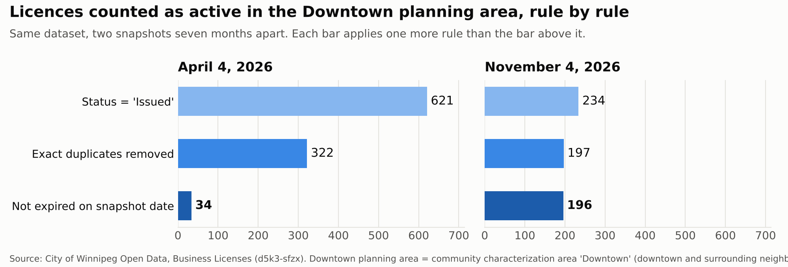
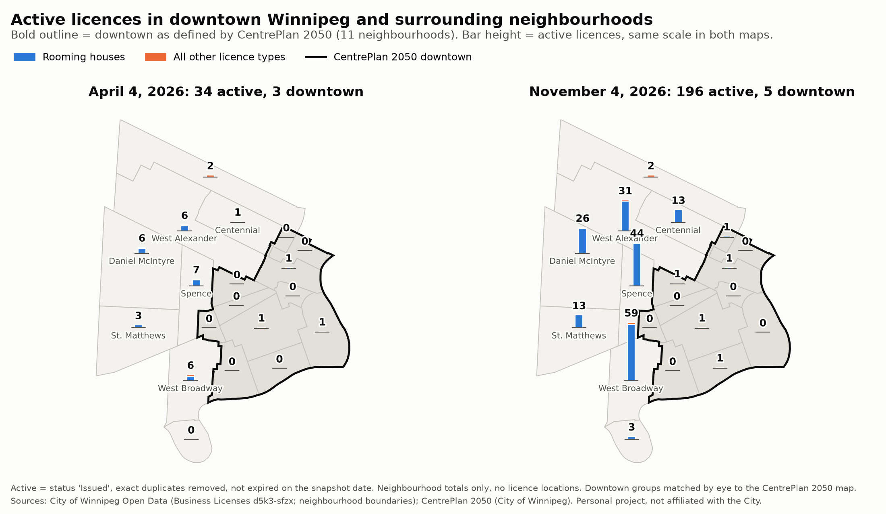

# Winnipeg Business Licence Data Governance

> **Status: work in progress (Phase 1 of 3).** Personal portfolio project on public data. Not affiliated with or endorsed by the City of Winnipeg.

**Question:** Can the City of Winnipeg's business licence open data be trusted to count active licensed businesses downtown, what would it take to make it trustworthy, and what can it never tell you?

## Findings so far

**1. The data can't count downtown businesses in general.** The City licenses only a short list of activities (used goods and precious metal dealers, rooming houses and similar). A restaurant or an office will never appear in this dataset. Any "downtown business count" built on it measures licensed activities only.

**2. In April 2026, a naive count for the Downtown planning area was about 18 times too high.** (The licence data's "Downtown" planning area covers downtown and surrounding neighbourhoods; see finding 4.)



| Downtown planning area licences | April 4, 2026 | November 4, 2026 |
|---|---:|---:|
| Status = "Issued" | 621 | 234 |
| ...after removing exact duplicate rows | 322 | 197 |
| ...and not expired on the snapshot date | **34** | **196** |

In April, 1,655 records across the city still said "Issued" after their expiry date. By November that number was 1.

**3. My November API pull looked very different from the April export, and the portal doesn't say why.**

- **Status corrections are real source changes.** All 436 matched records that were "Issued" but expired in April now show a closed or ceased status.
- **The growth may be partly how each file was extracted.** Within the April file's date range, both files hold nearly the same number of distinct records (3,231 versus 3,306). The extra rows are history back to 2010 and two more licence families, which the April export didn't include. Whether the City added them or the April export was a filtered view is unconfirmed.
- Exact duplicate rows fell from 55.8% to 15.6%. Personal sales duplicates went from 3,585 rows to 0. These could also be an export artifact rather than a fix at the source.

Either way, two people pulling the "same" dataset seven months apart got very different files, and nothing on the portal documents the difference.

**4. The City's own downtown has almost none of these licences.** The licence data's "Downtown" planning area is wider than downtown. CentrePlan 2050, the City's downtown plan bylaw, draws a much tighter boundary. Of November's 196 active licences in the planning area:

| Area | Active, Nov 2026 |
|---|---:|
| Downtown, as defined by CentrePlan 2050 (11 neighbourhoods) | 5 |
| Partly downtown (West Broadway, West Alexander, Centennial) | 103 |
| Surrounding neighbourhoods (Spence, Daniel McIntyre, St. Matthews, Armstrong Point, Logan-C.P.R.) | 88 |

187 of the 196 were rooming houses. Four neighbourhoods inside downtown, including Portage & Main, have no licence records at all, because nothing there holds one of the City's licensed activities.



Exact numbers by neighbourhood: [chart](reports/figures/downtown_by_neighbourhood.png) and [table](reports/downtown_by_neighbourhood.csv). Group membership: [downtown_definitions.csv](metadata/downtown_definitions.csv).

**Not yet proven:**
- Why the April duplicates existed. With no licence number in the data, an exact duplicate can't be confirmed as an error. Rooming house addresses are redacted, so separate rooming houses can look identical.
- Whether the remaining rooming house duplicates are errors or distinct licences.
- The exact CentrePlan 2050 boundary. Neighbourhoods were matched to the plan's published map by eye; Logan-C.P.R. is the least certain. A GIS file of the boundary would confirm it.

## Why this matters

Business licence data is the kind of source people reach for when they want to measure downtown activity. I used this exact file in an earlier downtown analysis and described it as a record of who is open for business. It isn't: it covers a short list of licensed activities, its "Downtown" label includes surrounding neighbourhoods, and in April its statuses had not been updated after licences expired.

None of that shows up as an error message. The values are well formed; the problem is **undocumented meaning**. There are no field definitions, no licence ID, no changelog and no published redaction rule, so two people can pull the same dataset and honestly report 621, 196 or 5 "active downtown licences" depending on the day and the definition.

That is a governance problem, not a coding one, and it is cheap to fix at the source. The [charter](governance/charter.md) (section 7) lists six controls the City could add, each tied to a gap found here.

## Design decisions

Each choice is logged with its reasons in the [decision log](governance/decision_log.md).

| Decision | Why | Trade-off |
|---|---|---|
| Analyze dated snapshots, never the live API (D-003) | Every figure traces to one pull, and two pulls can be compared | Numbers are only as current as the last pull |
| Keep raw records out of the repo (D-004) | Some licence types include addresses that may belong to individuals | Readers re-pull the data themselves; the April file is identified by its hash |
| Read every source through one loader and schema | The CSV export and the API use different headers, date formats and missing-field rules | One more layer to maintain |
| Treat codes as text and join by normalized name (D-006) | Neighbourhood codes lost trailing zeros, and the licence and boundary files share no key; the map script stops on any unmatched name | Name matching depends on spelling, so it is checked on every run |
| Write definitions down instead of trusting labels (D-007, D-010) | The City defines none of its fields; "Downtown" in the data is wider than the City's own downtown plan | Working definitions are this project's, and are labelled that way |
| Report "partly downtown" as its own group | Three neighbourhoods are only partly inside CentrePlan 2050, and withheld addresses make them impossible to split | A three-way answer instead of one number |
| Count exact duplicates but don't call them errors | With no licence ID, a duplicate can't be proven wrong | The duplicate rate is a signal, not a verdict |
| Compute numbers in code, write meanings by hand | The data dictionary can't drift from the data | Definitions need a human review when the data changes |
| Show neighbourhood totals only, never licence locations | Privacy, consistent with D-004 | No street-level detail |

## How it works

```
City open data API ──► ingest_api.py ──► dated raw snapshot (local only)
                                               │
                       load_snapshot.py  ◄───────┘  (also reads the April CSV)
                           │
         ┌─────────────────┴──────────────────┐
 profile_extract.py                   compare_snapshots.py
         │                                    │
 reports/profile_*.md            reports/compare_*.md
```

- `src/ingest_api.py` pulls the full dataset from the City's API, checks the row count, and saves a dated snapshot that is never overwritten.
- `src/load_snapshot.py` reads either the API snapshot or a CSV export into one standard format, using `metadata/field_mapping.csv`.
- `src/profile_extract.py` profiles one snapshot.
- `src/compare_snapshots.py` compares two snapshots.
- `src/make_figures.py` draws the funnel chart from the same function the comparison report uses.
- `src/make_map.py` joins licences to neighbourhood boundaries by name, groups neighbourhoods using `metadata/downtown_definitions.csv`, and draws the map and ranked chart (neighbourhood totals only).
- `src/build_data_dictionary.py` builds the [data dictionary](metadata/data_dictionary.md) from hand-written definitions plus figures computed from a snapshot.

Reports show counts only. Raw data is not stored in this repo; see [data/README.md](data/README.md).

Governance: [charter](governance/charter.md), [RACI](governance/raci.md), [decision log](governance/decision_log.md), [issue log](governance/issue_log.md) and [snapshot register](governance/snapshots.md). Quality: [rules](quality/quality_rules.md).

**Metadata types:** business metadata in `field_definitions.csv` and `downtown_definitions.csv`, technical metadata in `field_mapping.csv` (a source-to-target spec with transformation, validation and error handling), operational metadata in `pull_metadata.json` and the profile reports. The diagram above is **as-designed** lineage; the snapshot register and pull metadata are the evidence of what actually ran.

**Grain:** the City does not document what one row represents, so it is recorded as unknown (D-011). This is why exact duplicates are counted but not called errors.

## Run it

```bash
pip install -r requirements.txt
python src/ingest_api.py
python src/profile_extract.py data/raw/api_YYYYMMDD YYYY-MM-DD
```

## Roadmap (DAMA-DMBOK knowledge areas)

| Deliverable | Knowledge area | Status |
|---|---|---|
| **Phase 1: Foundation & Baseline Audit** | | |
| Profiling and snapshot comparison | Data Quality | Done |
| API ingestion with immutable snapshots | Data Integration | Done (first version) |
| Data dictionary | Metadata Management | Done |
| Governance charter, RACI, decision log | Data Governance | Done (v0.1) |
| Quality rules and issue log | Data Quality | Done (v0.1; three rules not yet computed) |
| Snapshot retention rule | Data Storage & Operations | Done (snapshot register) |
| **Phase 2: Governance Artifacts & BI Layer** | | |
| Quality scorecard | Data Quality | Next |
| Business glossary and lineage diagram | Metadata Management | Phase 2 |
| Reference code lists (families, activities, statuses, downtown groups) with versions and effective dates | Reference & Master Data | Phase 2 |
| Record matching: deterministic rules, steward review and match-link only (no auto-merge, since redacted addresses make false positives likely) | Reference & Master Data | Phase 2 |
| Field classification and access matrix | Data Security | Phase 2 |
| Conceptual, logical and physical model | Data Modeling & Design | Phase 2 |
| Power BI quality scorecard and insight page | DW & BI | Phase 2 |
| Pipeline and storage architecture (the diagram above, documented) | Data Architecture | Phase 2 |
| **Phase 3: Analytics Engineering & Automated Testing Gates** | | |
| `dbt-duckdb` ELT transformation pipeline (staging, intermediate, and dimensional marts) | Data Integration & Modeling | Phase 3 |
| Automated data quality gates in dbt (schema constraints, null checks, accepted value assertions) | Data Quality | Phase 3 |
| Custom singular assertions (validity tests catching expired "Issued" licences and spatial boundary drift) | Data Quality | Phase 3 |
| Dynamic data lineage graph (DAG) and self-documenting catalog via dbt docs | Metadata Management | Phase 3 |
| CI/CD testing workflow (automated test assertions executing on pull requests) | Data Architecture | Phase 3 |
| **Out of Scope** | | |
| Document and Content Management | | Out of scope (no documents or unstructured content in the source) |

## Source

City of Winnipeg Open Data, Business Licenses (dataset `d5k3-sfzx`), data.winnipeg.ca. Snapshots: April 4, 2026 (CSV export) and November 4, 2026 (API pull).
